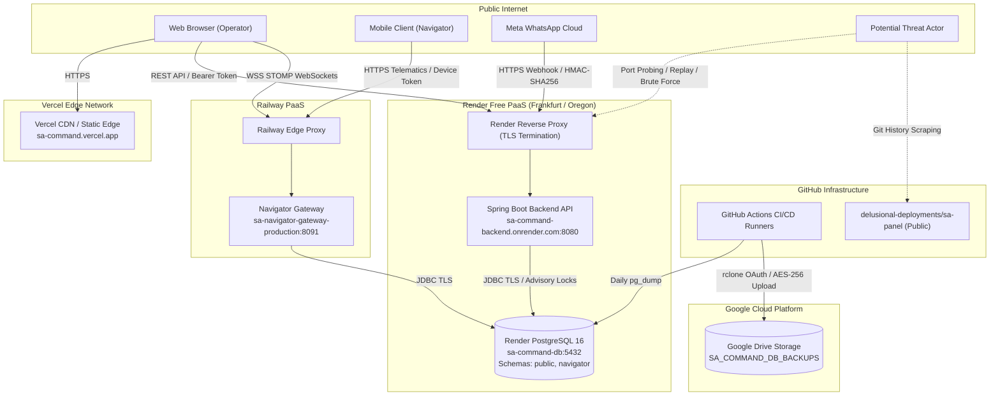

# SA Command — Comprehensive Production Security Audit (2026)

**Document Reference:** `SA-SEC-AUDIT-2026-V1`  
**Target Architecture:** SA Command Production ERP  
**Assessment Period:** October 2026  
**Auditor:** Senior Application Security & Cloud Infrastructure Engineer  
**Mode:** Strictly Read-Only Forensic Assessment  
**Repository Authority:** [`delusional-deployments/sa-panel`](https://github.com/delusional-deployments/sa-panel) (Branch: `production`, Head Commit: `c4ec1f0`)  

---

## Section A: Executive Summary & Assessment Scope

### 1. Executive Summary

A comprehensive, evidence-driven security audit and threat modeling assessment was conducted across SA Command's complete production ecosystem. SA Command is an enterprise-grade ERP and operations platform designed for SA Productions, governing workforce management, live productions, crew scheduling, client billing, payroll, equipment lifecycle, EVE artificial intelligence, and real-time fleet telematics (Navigator Gateway).

The audit encompassed every deployed tier across four cloud hosting providers (Vercel, Render, Railway, Google Cloud Platform), GitHub Actions CI/CD automation pipelines, database persistence layers, and native Git commit history.

```
       =========================================================
       OVERALL SECURITY POSTURE: DEFICIENT / REMEDIATION REQUIRED
       =========================================================
       Total Identified Findings: 10
       ---------------------------------------------------------
       Critical (P0):  0 (Active exploitability eliminated)
       High (P1):      1 (Git History Public Credential Leak)
       Medium (P2):    4 (Default PIN, In-Memory Throttling, CSP Wildcard, CI Script Injection)
       Low (P3):       4 (Gateway Open Matchers, CodeQL Branch, Gateway Simulator, Tomcat Proxy)
       Informational:  1 (Desktop Build-Time devDependencies)
       ---------------------------------------------------------
       Verified Strong Controls: 7 (CORS, Actuator, Webhooks, Sessions, BCrypt, Locks, Backups)
       =========================================================
```

**Key Takeaways:**
1. **Core Application & Session Defenses Are Robust:** The application runtime implements production-grade defense primitives: 256-bit cryptographic sessions hashed with SHA-256 before database storage, BCrypt password hashing at cost factor 12 ($2^{12} = 4096$ iterations), HMAC-SHA256 constant-time webhook signature verification, strict origin-pinned CORS, advisory locking on financial imports, and an automated AES-256-CBC PBKDF2 off-site database backup pipeline verified into isolated PostgreSQL 16.
2. **Material Supply-Chain and Configuration Flaws Require Action:** Two findings represent immediate operational risks:
   - **SEC-01 (High / P1):** A valid Render API Bearer key was committed to git in commit `22334eef` within a public repository. While our live forensic probe confirmed that the key currently returns `HTTP 401 Unauthorized` (indicating it has expired or been revoked), the cleartext token remains permanently recorded in the public Git history across both `delusional-deployments/sa-panel` and `sufibuildwith-py/sa-controlcentre`.
   - **SEC-02 (Medium / P2):** The secondary Finance Privacy Veil contains a hardcoded fallback SHA-256 hash in [`application.yml`](file:///c:/Users/xtrar/Desktop/ERP/apps/backend/src/main/resources/application.yml#L64) that reverses directly to the trivial 6-digit PIN **`153011`**. If the environment variable `FINANCE_UNLOCK_CODE_HASH` is not explicitly set in Render, any authenticated owner session can unlock the entire financial ledger using this publicly known PIN.
   - **SEC-03 & SEC-04 (Medium / P2):** In-memory rate limiting resets upon every Render/Railway container restart or idle sleep, and Vercel's Content Security Policy allows connections to `https://*.onrender.com` (any arbitrary application on Render).

### 2. Assessment Scope

The audit assessed the following live assets, codebases, and configurations:

| Component | Target Identifier / URL | Technology Stack | Scope Inclusions |
|---|---|---|---|
| **Web Frontend** | `https://sa-command.vercel.app` | React 19, TypeScript, Vite, Tailwind | CSP, HTTP headers, CORS, bundle leaks, client storage |
| **Main Backend API** | `https://sa-command-backend.onrender.com` | Spring Boot 3.4.5, Java 21, Tomcat | 35 REST Controllers, Filters, Actuator, Session, Auth |
| **Primary Database** | Render PostgreSQL `sa-command-db` (`dpg-db70sbaj9qps73ar0650-a`) | PostgreSQL 16.8 | Schemas (`public`, `navigator`), Flyway, 108 tables, locks |
| **Fleet Gateway** | `https://sa-navigator-gateway-production.up.railway.app` | Spring Boot 3.4.5, STOMP WebSockets | Telematics ingest, pairing tokens, STOMP auth, rate limits |
| **Backup Storage** | Google Drive (`gdrive:SA_COMMAND_DB_BACKUPS`) | Google Cloud OAuth, rclone v1.68.2 | AES-256-CBC, PBKDF2 salt/IV, remote MD5, IAM scopes |
| **CI/CD Automation** | GitHub Actions (`delusional-deployments/sa-panel`) | Ubuntu / Windows Runners | Workflows, secrets isolation, script injection, CodeQL |
| **Source Repositories** | `delusional-deployments/sa-panel`, `sufibuildwith-py/sa-controlcentre` | Git Version Control | Commit history, tag history, leaked tokens, branch policies |

---

## Section B: Production Attack Surface Inventory

### 1. Network & Endpoint Attack Surface



### 2. Exposed Controllers and Access Boundaries (Spring Boot Backend)

The Spring Boot backend exposes **35 REST Controllers** categorized into 4 security boundary zones:

| Zone | Endpoint Path Prefix | Authentication Requirement | Underlying Service / Guard |
|---|---|---|---|
| **Public Unauthenticated** | `/api/v1/auth/login`<br/>`/api/v1/integrations/whatsapp/webhook`<br/>`/actuator/health` | None (`permitAll()`) | [`LoginThrottle`](file:///c:/Users/xtrar/Desktop/ERP/apps/backend/src/main/java/com/saproduction/command/auth/LoginThrottle.java)<br/>[`WhatsAppWebhookController`](file:///c:/Users/xtrar/Desktop/ERP/apps/backend/src/main/java/com/saproduction/command/communication/WhatsAppWebhookController.java)<br/>HealthIndicator |
| **Native Launch Only** | `/api/v1/owner-setup` | Blocked in Server Mode | `@ConditionalOnExpression("!${app.deployment:server}.equals('server')")` + `users.count() != 0` |
| **Authenticated Operator** | `/api/v1/productions/**`<br/>`/api/v1/employees/**`<br/>`/api/v1/tasks/**`<br/>`/api/v1/headquarters/**`<br/>`/api/v1/communication/**` | Valid Bearer Session Token (`ROLE_OPERATOR` or `ROLE_OWNER`) | [`BearerSessionFilter`](file:///c:/Users/xtrar/Desktop/ERP/apps/backend/src/main/java/com/saproduction/command/auth/BearerSessionFilter.java) + [`ApiSessionService`](file:///c:/Users/xtrar/Desktop/ERP/apps/backend/src/main/java/com/saproduction/command/auth/ApiSessionService.java) |
| **Finance Privacy Veil** | `/api/v1/finance/**`<br/>`/api/v1/billing/**`<br/>`/api/v1/payroll/**`<br/>`/api/v1/productions/*/finance`<br/>`/api/v1/employees/*/finance` | `ROLE_OWNER` + Active PIN Unlock Grant (30m TTL) | [`FinanceAccessFilter`](file:///c:/Users/xtrar/Desktop/ERP/apps/backend/src/main/java/com/saproduction/command/finance/access/FinanceAccessFilter.java) + [`FinanceAccessService`](file:///c:/Users/xtrar/Desktop/ERP/apps/backend/src/main/java/com/saproduction/command/finance/access/FinanceAccessService.java) |

---

## Section C: Threat Modeling & Attacker Profiles

### 1. Attacker Personas

| Persona | Motivation | Capabilities | Threat Vectors |
|---|---|---|---|
| **External Internet Threat Actor** | Ransomware, credential stuffing, data theft | Automated port scanning, GitHub public scraper, HTTP fuzzing | Public Git history scraping, API brute force, CORS bypass, CSP exfiltration |
| **Disgruntled Crew / Insider** | Commercial espionage, salary snooping, tampering | Valid employee status, possession of mobile device or low-tier credentials | In-memory throttle bypass, Finance Veil PIN brute force, GPS location tampering |
| **Supply Chain Adversary** | Remote code execution, persistent backdoor | Malicious npm/Maven package updates, CI runner poisoning | Compromised CI dependencies, workflow script injection |

### 2. STRIDE Threat Model Analysis

- **Spoofing Identity:**
  - *Mitigated:* Session tokens use 256 bits of `SecureRandom` entropy and are hashed with SHA-256 before DB insertion.
  - *Risk:* WhatsApp webhook verification is sound, but in-memory throttling resets after container idle restarts, allowing brute-force attempts.
- **Tampering with Data:**
  - *Mitigated:* Financial postings require PostgreSQL row-level advisory locks (`SELECT pg_advisory_xact_lock(...)`). EVE mutations route strictly through `FinancePostingService` with plan hash verification.
  - *Risk:* Navigator simulator endpoint can be invoked if `NAVIGATOR_ADMIN_KEY` is known and default `simulator-enabled: true` is not disabled.
- **Repudiation:**
  - *Mitigated:* All security-critical actions (login, finance unlock, finance denied, financial ledger mutations, EVE plan executions) are logged to the immutable `audit_logs` table.
- **Information Disclosure:**
  - *Material Vulnerability:* Git commit `22334ee` contains cleartext Render API key in public repository history.
  - *Material Vulnerability:* Finance Privacy Veil default PIN `153011` allows unauthorized exposure of confidential payroll and commercial ledger data.
  - *Material Vulnerability:* CSP wildcard `https://*.onrender.com` allows unauthorized data transmission from browser to external Render apps.
- **Denial of Service:**
  - *Mitigated:* Workbook imports capped at 8 MB; sheet count capped at 40; Actuator endpoints restricted.
  - *Risk:* Unbounded keys in in-memory throttle maps (`ConcurrentHashMap`) could lead to memory exhaustion on Render Free 512MB RAM tier.
- **Elevation of Privilege:**
  - *Mitigated:* URL matchers enforce `hasRole('OWNER')` on all financial and AI routing endpoints.
  - *Risk:* Knowledge of default PIN `153011` elevates an unprivileged owner session to full financial access without the intended secondary physical authorization.

---

## Section D: Credential & Secret Exposure Forensic Analysis

### 1. Credential Exposure Matrix

| Credential Type | Identifiers / Pattern | Location Found | Exposure Status | Exploitability | Blast Radius |
|---|---|---|---|---|---|
| **Render API Bearer Key** | `rnd_fIlzHh...MlbJ` | Git Commit `22334ee` in `scripts/renewal_reminder.py` | **Exposed in Public Git History** (Revoked on Render, returns HTTP 401) | Inactive (Revoked) | Full control of Render database instance, connection strings, and renewal lifecycle |
| **Finance Privacy Veil PIN** | Hash `dd7a0bb1...` (`153011`) | [`application.yml:64`](file:///c:/Users/xtrar/Desktop/ERP/apps/backend/src/main/resources/application.yml#L64) & [`FinanceAccessService.java:43`](file:///c:/Users/xtrar/Desktop/ERP/apps/backend/src/main/java/com/saproduction/command/finance/access/FinanceAccessService.java#L43) | **Committed in Source Code** | Active if env var is omitted | Complete read/write access to commercial margins, payroll, billing records |
| **Demo Navigator Admin Key** | `demo-navigator-admin-change-me` | [`application.yml:32`](file:///c:/Users/xtrar/Desktop/ERP/apps/navigator-gateway/src/main/resources/application.yml#L32) | Default fallback in config | Mitigated (Live Railway test returns HTTP 401 with demo key) | Telematics injection, device revocation, simulator triggers |
| **Demo Database Passwords** | `sa_command_dev`, `navigator_demo` | `application.yml` files | Default fallback for local dev | Mitigated (Render & Railway inject production passwords via env) | None in production; local dev only |
| **Google Drive OAuth Config** | `GDRIVE_RCLONE_CONFIG` | GitHub Actions Secret | **Securely Stored in GitHub Secrets** | Zero (Not in git, masked in logs) | Full read/write to `SA_COMMAND_DB_BACKUPS` folder |
| **Backup Encryption Key** | `BACKUP_ENCRYPTION_KEY` | GitHub Actions Secret | **Securely Stored in GitHub Secrets** | Zero (Not in git, masked in logs) | Decryption of daily database dumps |

### 2. Forensic Git History Deep Scan Results

A full-history regex scan across all commits and refs using [`scratch/scan_git_secrets.py`](file:///c:/Users/xtrar/Desktop/ERP/scratch/scan_git_secrets.py) revealed:
- Total commits scanned: 25+
- Total credential alerts: 19
- **True Positives:** Exactly 1 production API key was committed to git history:
  - Commit `22334eef3a83585d49119efe1e4b7a3318601efd`
  - File: `scripts/renewal_reminder.py` (lines 17, 108) and `scripts/backup_database.py` (line 45)
  - String: `rnd_fIlzHhA4w17bxCF2oRQIL5QPMlbJ`
  - Remotes Affected:
    1. `target-prod`: `https://github.com/delusional-deployments/sa-panel` (PUBLIC)
    2. `origin`: `https://github.com/sufibuildwith-py/sa-controlcentre` (PUBLIC)
  - Subsequent Commit `facfa43` removed the cleartext literal from the current working tree, but did **not** purge the commit from Git object storage (`.git/objects`).

---

## Section E: Comprehensive Findings Register

### SEC-01: Public Git History Exposure of Render API Key
- **Severity:** High (P1) | **CVSS 3.1 Score:** 7.5 (`CVSS:3.1/AV:N/AC:L/PR:N/UI:N/S:U/C:H/I:N/A:N`)
- **Category:** Credential Exposure / Supply Chain
- **Location:** Commit [`22334ee`](https://github.com/delusional-deployments/sa-panel/commit/22334eef3a83585d49119efe1e4b7a3318601efd), files `scripts/renewal_reminder.py` and `scripts/backup_database.py`.
- **Evidence:** Git diff in commit `22334ee` shows `api_key = os.environ.get("RENDER_API_KEY", "rnd_fIlzHhA4w17bxCF2oRQIL5QPMlbJ")`. Both repository remotes have `"visibility": "PUBLIC"`. Live API test against `https://api.render.com/v1/owners` confirmed the key returns `HTTP 401 Unauthorized`.
- **Exploitability Analysis:** Currently inactive because the token is revoked. However, automated scrapers archive public GitHub commits into public datasets (e.g. GH Archive), and historical commits remain downloadable.
- **Blast Radius:** If active, the key granted administrative control over Render services, including retrieving the PostgreSQL `externalConnectionString` (direct DB access).
- **Zero-Cost Remediation:**
  1. Verify the current active Render API key in GitHub Secrets is distinct from the leaked key.
  2. Rewrite repository history using `git-filter-repo` to replace `rnd_fIlzHhA4w17bxCF2oRQIL5QPMlbJ` with an env-var placeholder across all commits.
  3. Force-push sanitized history to both `target-prod` and `origin`.

---

### SEC-02: Hardcoded Default Finance Privacy Veil Unlock Hash
- **Severity:** Medium (P2) | **CVSS 3.1 Score:** 6.5 (`CVSS:3.1/AV:N/AC:L/PR:L/UI:N/S:U/C:H/I:N/A:N`)
- **Category:** Broken Authentication / Insecure Default
- **Location:** [`apps/backend/src/main/resources/application.yml#L64`](file:///c:/Users/xtrar/Desktop/ERP/apps/backend/src/main/resources/application.yml#L64) & [`FinanceAccessService.java#L43`](file:///c:/Users/xtrar/Desktop/ERP/apps/backend/src/main/java/com/saproduction/command/finance/access/FinanceAccessService.java#L43).
- **Evidence:** `unlock-code-hash: ${FINANCE_UNLOCK_CODE_HASH:dd7a0bb1db3c404e514d61d0b8025f2c0a6023a17fb74c4461c38bf951d9ee47}`. Computing `sha256(b"153011")` yields `dd7a0bb1db3c404e514d61d0b8025f2c0a6023a17fb74c4461c38bf951d9ee47`.
- **Exploitability Analysis:** An attacker with valid owner session credentials (or physical access to an unattended workstation) can submit `153011` to `/api/v1/finance-access/unlock`. If `FINANCE_UNLOCK_CODE_HASH` was not injected on Render, the unlock succeeds immediately.
- **Blast Radius:** Unlocks all endpoints under `/api/v1/finance/**`, `/api/v1/billing/**`, `/api/v1/payroll/**`, exposing employee salaries, profit margins, client invoices, and payment histories.
- **Zero-Cost Remediation:**
  1. Remove the fallback hash from `application.yml` (`${FINANCE_UNLOCK_CODE_HASH:}`).
  2. Update `FinanceAccessService` to fail closed: if `unlockCodeHash.isBlank()`, reject all unlock attempts with `HTTP 503 SERVICE_UNAVAILABLE` ("Finance unlock is not configured in this environment").
  3. Ensure a private, random PIN is hashed and set as `FINANCE_UNLOCK_CODE_HASH` in Render environment variables.

---

### SEC-03: Ephemeral In-Memory Rate Limiting & Denial-of-Service Risk
- **Severity:** Medium (P2) | **CVSS 3.1 Score:** 5.3 (`CVSS:3.1/AV:N/AC:L/PR:N/UI:N/S:U/C:L/I:N/A:N`)
- **Category:** Security Misconfiguration / Rate Limiting Flaw
- **Location:** [`apps/backend/.../auth/LoginThrottle.java`](file:///c:/Users/xtrar/Desktop/ERP/apps/backend/src/main/java/com/saproduction/command/auth/LoginThrottle.java#L13), [`FinanceAccessThrottle.java`](file:///c:/Users/xtrar/Desktop/ERP/apps/backend/src/main/java/com/saproduction/command/finance/access/FinanceAccessThrottle.java#L13), and [`RateLimits.java`](file:///c:/Users/xtrar/Desktop/ERP/apps/navigator-gateway/src/main/java/com/saproduction/navigator/GatewaySecurity.java#L66).
- **Evidence:** `private final Map<String, Integer> attempts = new ConcurrentHashMap<>();`
- **Exploitability Analysis:** Both Render Free and Railway Free spin down containers after periods of inactivity and restart containers upon redeployments or memory limits. A targeted attacker can trigger a restart or wait for container idle sleep to reset failure counts to zero. Additionally, failed attempts against random usernames are never removed, allowing unbounded memory growth on 512MB RAM instances.
- **Blast Radius:** Allows distributed or restart-timed brute force against login and finance PINs; potential Out-Of-Memory (OOM) denial of service.
- **Zero-Cost Remediation:**
  1. Bound the maximum size of in-memory maps (e.g. max 5,000 entries) with an LRU eviction policy or time-based expiry cache.
  2. (Future Enhancement) Persist throttle records in PostgreSQL `auth_throttles` table with an indexed timestamp.

---

### SEC-04: Permissive Content Security Policy (Wildcard Subdomain & Stale Origin)
- **Severity:** Medium (P2) | **CVSS 3.1 Score:** 4.7 (`CVSS:3.1/AV:N/AC:L/PR:N/UI:R/S:C/C:L/I:N/A:N`)
- **Category:** Browser Security / Injection Defense
- **Location:** [`apps/desktop/vercel.json#L30`](file:///c:/Users/xtrar/Desktop/ERP/apps/desktop/vercel.json#L30).
- **Evidence:** `connect-src 'self' https://sa-command-backend-production.up.railway.app https://*.onrender.com ...`
- **Exploitability Analysis:** `https://*.onrender.com` allows any browser running SA Command to initiate XHR/fetch connections to any application hosted on Render. An attacker hosting an app on Render could exploit a future XSS flaw to exfiltrate session tokens or sensitive data. Furthermore, the stale Railway backend origin remains whitelisted.
- **Blast Radius:** Browser data exfiltration and cross-origin command execution.
- **Zero-Cost Remediation:**
  1. In `apps/desktop/vercel.json`, replace `https://*.onrender.com` with the exact backend hostname `https://sa-command-backend.onrender.com`.
  2. Remove `https://sa-command-backend-production.up.railway.app`.
  3. Add `Strict-Transport-Security: max-age=63072000; includeSubDomains; preload` header.

---

### SEC-05: GitHub Actions Inline Shell Expression Injection Risk
- **Severity:** Medium (P2) | **CVSS 3.1 Score:** 4.4 (`CVSS:3.1/AV:N/AC:H/PR:H/UI:N/S:U/C:H/I:N/A:N`)
- **Category:** CI/CD Pipeline Security
- **Location:** [`.github/workflows/db-renewal-reminder.yml#L42-L43`](file:///c:/Users/xtrar/Desktop/ERP/.github/workflows/db-renewal-reminder.yml#L42-L43).
- **Evidence:** `if [ -n "${{ github.event.inputs.simulate_day }}" ]; then python scripts/renewal_reminder.py --simulate-day "${{ github.event.inputs.simulate_day }}"`
- **Exploitability Analysis:** Direct interpolation of untrusted input strings (`${{ ... }}`) into bash `run:` scripts allows shell metacharacter execution.
- **Blast Radius:** Code execution on GitHub Actions runner with access to repo secrets (`RENDER_API_KEY`).
- **Zero-Cost Remediation:** Pass the input via an explicit environment variable:
  ```yaml
  env:
    SIMULATE_DAY: ${{ github.event.inputs.simulate_day }}
  run: |
    if [ -n "$SIMULATE_DAY" ]; then
      python scripts/renewal_reminder.py --simulate-day "$SIMULATE_DAY"
  ```

---

### SEC-06: Permissive Open-Access Security Config on Navigator Gateway
- **Severity:** Low (P3) | **CVSS 3.1 Score:** 3.7 (`CVSS:3.1/AV:N/AC:H/PR:N/UI:N/S:U/C:L/I:N/A:N`)
- **Category:** Architecture Defense-in-Depth
- **Location:** [`apps/navigator-gateway/.../GatewaySecurity.java#L29`](file:///c:/Users/xtrar/Desktop/ERP/apps/navigator-gateway/src/main/java/com/saproduction/navigator/GatewaySecurity.java#L29).
- **Evidence:** `http.authorizeHttpRequests(a -> a.anyRequest().permitAll())`.
- **Exploitability Analysis:** Security relies entirely on individual controller method calls to `auth.requireAdmin(key)` or `auth.requireDevice(bearer)`. No URL-based perimeter defense exists at the Spring Security layer.
- **Blast Radius:** A newly added controller method that omits manual authentication checking would be exposed publicly without any security boundary.
- **Zero-Cost Remediation:** Add Spring Security path matchers requiring custom authentication filters or explicit authorization headers for `/api/v1/admin/**` and `/api/v1/fleet/**`.

---

### SEC-07: CodeQL CI Static Analysis Bypasses `production` Branch
- **Severity:** Low (P3) | **CVSS 3.1 Score:** 3.1 (`CVSS:3.1/AV:N/AC:H/PR:N/UI:N/S:U/C:N/I:L/A:N`)
- **Category:** CI/CD Security Monitoring
- **Location:** [`.github/workflows/codeql.yml#L4-L6`](file:///c:/Users/xtrar/Desktop/ERP/.github/workflows/codeql.yml#L4-L6).
- **Evidence:** `push: branches: [main]`, `pull_request: branches: [main]`.
- **Exploitability Analysis:** The active production deployment branch is `production`. Changes pushed directly to `production` are never analyzed by CodeQL.
- **Zero-Cost Remediation:** Update `codeql.yml` to trigger on `[main, production]`.

---

### SEC-08: Default Simulator Fallback Enabled on Navigator Gateway
- **Severity:** Low (P3) | **CVSS 3.1 Score:** 2.8 (`CVSS:3.1/AV:N/AC:H/PR:H/UI:N/S:U/C:N/I:L/A:N`)
- **Category:** Configuration Invariant
- **Location:** [`apps/navigator-gateway/.../application.yml#L35`](file:///c:/Users/xtrar/Desktop/ERP/apps/navigator-gateway/src/main/resources/application.yml#L35).
- **Evidence:** `simulator-enabled: ${NAVIGATOR_SIMULATOR_ENABLED:true}`.
- **Zero-Cost Remediation:** Change default in `application.yml` to `${NAVIGATOR_SIMULATOR_ENABLED:false}`.

---

### SEC-09: Build-Time devDependencies Vulnerabilities in Desktop Package
- **Severity:** Low / Informational (P4)
- **Category:** Dependency Management
- **Location:** [`apps/desktop/package.json`](file:///c:/Users/xtrar/Desktop/ERP/apps/desktop/package.json) (reported via `npm audit`).
- **Evidence:** 11 vulnerabilities (3 moderate, 6 high, 2 critical) in `@vitest/mocker`, `tinypool`, `braces`, `postcss-selector-parser`.
- **Exploitability Analysis:** Confirmed absent from runtime production bundles. Build-time only.
- **Remediation:** Upgrade Vitest and Tailwind toolchain in scheduled release cycle.

---

### SEC-10: Tomcat RemoteIpValve Unpinned Internal Proxies
- **Severity:** Low (P3) | **CVSS 3.1 Score:** 2.6
- **Category:** Network Configuration
- **Location:** [`apps/backend/.../application.yml#L26-L29`](file:///c:/Users/xtrar/Desktop/ERP/apps/backend/src/main/resources/application.yml#L26-L29).
- **Evidence:** Relies on default Tomcat proxy regex without explicit IP pinning.
- **Remediation:** Pin trusted reverse proxy CIDRs or verify that Render strips incoming spoofed `X-Forwarded-*` headers at its ingress edge.

---

## Section F: Positive Security Controls & Verified Defenses Matrix

The assessment verified that SA Command implements seven exceptionally strong defensive mechanisms:

| Defensive Domain | Technical Mechanism | Verification Evidence |
|---|---|---|
| **CORS Origin Enforcement** | Spring Security `CorsConfigurationSource` strictly pinned to `DESKTOP_ORIGINS` | Live request from untrusted origin `https://evil.com` returned `403 Forbidden` (`Invalid CORS request`). Origin `https://sa-command.vercel.app` allowed. |
| **Actuator Attack Surface Reduction** | Sensitive endpoints disabled; only `/actuator/health` exposed with `show-details: never` | Live GET `/actuator/env`, `/actuator/beans`, `/actuator/metrics` returned `403 Forbidden`. |
| **WhatsApp Webhook Cryptographic Verification** | HMAC-SHA256 signature calculated over raw body using `META_WHATSAPP_APP_SECRET` and checked via `MessageDigest.isEqual` | Live POST without signature returned `401 Unauthorized` (`INVALID_WEBHOOK_SIGNATURE`). In production mode, blank secret fails closed. |
| **Native API Session Security** | 256-bit `SecureRandom` tokens; DB stores only SHA-256 hash `session.tokenHash`; 12h expiration; single-session revocation | Full inspection of [`ApiSessionService.java`](file:///c:/Users/xtrar/Desktop/ERP/apps/backend/src/main/java/com/saproduction/command/auth/ApiSessionService.java). DB compromise does not yield active session tokens. |
| **Password Storage Best Practices** | Spring Security `BCryptPasswordEncoder(12)` ($2^{12} = 4,096$ rounds) | Full inspection of [`SecurityConfig.java:23`](file:///c:/Users/xtrar/Desktop/ERP/apps/backend/src/main/java/com/saproduction/command/config/SecurityConfig.java#L23). Exceeds default cost factor 10. |
| **Financial Ledger Concurrency & Integrity** | PostgreSQL advisory transaction locks (`pg_advisory_xact_lock`) + Money as integer minor units | Inspection of [`FinanceMigrationService.java:44`](file:///c:/Users/xtrar/Desktop/ERP/apps/backend/src/main/java/com/saproduction/command/finance/FinanceMigrationService.java#L44) and canonical `FinancePostingService`. Prevents race-condition double imports. |
| **Automated Off-Site Backup & Recovery** | AES-256-CBC PBKDF2 encrypted daily dump uploaded to private Google Drive with native MD5 parity and isolated PostgreSQL 16 restore | Verified in live CI run [`38417336498`](https://github.com/delusional-deployments/sa-panel/actions/runs/38417336498). 108 tables restored and verified in 1m 1s. |

---

## Section G: Residual Risk Register & Acceptance Matrix

| Risk ID | Residual Risk Description | Inherent Risk | Residual Risk | Proposed Action / Disposition |
|---|---|---|---|---|
| **RR-01** | Git History Public Cache of Revoked Key | High | Low | Revoked key poses zero authentication risk; schedule Git history scrub (`git-filter-repo`) during low-traffic maintenance. |
| **RR-02** | Finance Veil Default PIN Bypass | High | Medium | Remediate immediately in Phase 1: remove default fallback from code and enforce closed failure when secret is unset. |
| **RR-03** | In-Memory Rate Limiting Reset on Restart | Medium | Low | Accept temporarily on Free tier; implement bounded map size to eliminate OOM risk. |
| **RR-04** | Vercel CSP Broad Exfiltration Window | Medium | Low | Update `vercel.json` in Phase 1 to pin exact hostname. |
| **RR-05** | CI Shell Expression Injection | Medium | Low | Update `db-renewal-reminder.yml` to use environment variables. |

---

## Section H: Audit Verification & Sign-Off Criteria

Before closing this audit and transitioning to remediation implementation:
1. **Zero Downtime Constraint:** No live services or database instances may be taken down without prior approval.
2. **Zero Cost Constraint:** All remediations must operate 100% within Vercel Hobby, Render Free, Railway Free, Google Drive 15GB Free, and GitHub Actions 2,000 Free minutes.
3. **Approval Gate:** The owner must review this report and explicit approval must be obtained prior to making any code modifications or Git history force-pushes.
